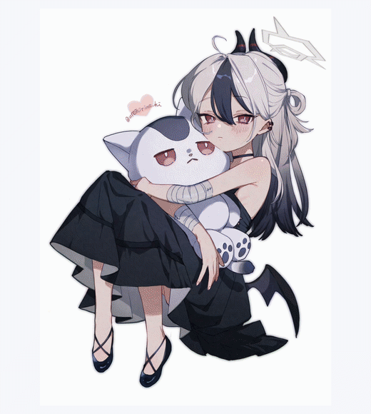

<h1 align="center">你好呀，我是 Kayokoi 👋</h1>

  <picture>
    <source media="(prefers-reduced-motion: reduce)" srcset="./assets/gallery-still.jpg" />
    
  </picture>

## 🌸 关于我

全栈开发 · AI 应用 · 开源贡献

  
  
  
  
   
  
  
  
  

## 🌱 GitHub 日常

  

  <picture>
    <source media="(prefers-color-scheme: dark)" srcset="./assets/github-contribution-grid-snake-dark.svg" />
    <source media="(prefers-color-scheme: light)" srcset="./assets/github-contribution-grid-snake.svg" />
    
  </picture>

<!-- PR_SUMMARY_START -->
**上游已采纳 13 项修复** · **本人 PR 合并 11** · **其他 PR 采纳 2** · **待跟进 46**

状态核查于 2026-11-01（北京时间）。已采纳 = 11 条本人 PR 直接合并 + SolidJS、Guava 两项经其他 PR 合入。SolidJS 原 PR #4539 已由维护者在 #4558 合入后关闭；其采纳记录单列，当前待跟进 46 条。仅统计外部上游，同一修复不重复计数。
<!-- PR_SUMMARY_END -->

另有 1 项修复被第三方 fork 正式采用（Sub2API，原上游仍待合并），在下方对应记录单列。

<!-- MERGED_TABLE_START -->
| 项目 | PR / 修复 | 状态 |
| :--- | :--- | :--- |
| [SolidJS](https://github.com/solidjs/solid) | [原 PR #4539](https://github.com/solidjs/solid/pull/4539) · [采纳 PR #4558](https://github.com/solidjs/solid/pull/4558) 修复乐观更新期间问题与数据帧不一致 | 修复已合入 `next`，由 Ryan 的 PR 接续并完善 <a href="https://github.com/solidjs/solid/commit/22cc9e4c6b097a0b6d7d149013f52f7568fab88d">原始作者 commit 22cc9e4</a> · <a href="https://github.com/solidjs/solid/commit/718ec9c218643dfe9943f05d33ccb66db53621c6">合入 commit 718ec9c</a> |
| [TokenHub](https://github.com/astaxie/TokenHub) | [#408](https://github.com/astaxie/TokenHub/pull/408) 移除 Anthropic 系统消息对旧版 beta 标记的依赖 |  main |
| [Guava](https://github.com/google/guava) | [原 PR #8807](https://github.com/google/guava/pull/8807) · [导入 PR #8811](https://github.com/google/guava/pull/8811) 修复基本类型数组旋转的 Integer.MIN_VALUE 溢出边界 | 修复已合入 `master`，经 Copybara 导入 [作者 commit c0a8a1e](https://github.com/google/guava/commit/c0a8a1edc69393e8141424037571d9825f5fc0f4) · 原 PR 为 Closed |
| [VS Code](https://github.com/microsoft/vscode) | [#344892](https://github.com/microsoft/vscode/pull/344892) 输入筛选与快捷键冲突 |  main |
| [MyBatis-Plus](https://github.com/baomidou/mybatis-plus) | [#7220](https://github.com/baomidou/mybatis-plus/pull/7220) 修复嵌套 Wrapper 条件的参数别名 |  |
| [Apache Dubbo](https://github.com/apache/dubbo) | [#16562](https://github.com/apache/dubbo/pull/16562) 使端口统一服务端遵循 keep-alive 配置 |  |
| [Haystack](https://github.com/deepset-ai/haystack) | [#13471](https://github.com/deepset-ai/haystack/pull/13471) 反序列化时保留 MockChatGenerator 输入 |  |
| [ccNexus](https://github.com/lich0821/ccNexus) | [#158](https://github.com/lich0821/ccNexus/pull/158) Chat 转 Responses 时保留工具调用历史 |  |
| [CLIProxyAPI](https://github.com/router-for-me/CLIProxyAPI) | [#7095](https://github.com/router-for-me/CLIProxyAPI/pull/7095) 修复跨分块 SSE 重组 |  dev |
| [ccstatusline](https://github.com/sirmalloc/ccstatusline) | [#757](https://github.com/sirmalloc/ccstatusline/pull/757) 回退到自动会话标题 |  main · <a href="https://github.com/sirmalloc/ccstatusline/commit/528c6860a70bd8f8dea83f46466c7d43af19edca">采纳 commit 528c686</a> |
| [gptme](https://github.com/gptme/gptme) | [#4520](https://github.com/gptme/gptme/pull/4520) 清理工作区时保护无关分支 |  master |
| [gptme](https://github.com/gptme/gptme) | [#4521](https://github.com/gptme/gptme/pull/4521) 隔离测试对本地 gh 的依赖 |  master |
| [ccNexus](https://github.com/lich0821/ccNexus) | [#157](https://github.com/lich0821/ccNexus/pull/157) 版本化 API 路由修复 |  master |
<!-- MERGED_TABLE_END -->

<!-- PR_LIST_START -->

查看 60 条上游 PR 及采纳记录

#### 本人 PR 已合并 · 11

- **[astaxie/TokenHub#408](https://github.com/astaxie/TokenHub/pull/408)** fix(anthropic): accept system messages without legacy beta

- **[baomidou/mybatis-plus#7220](https://github.com/baomidou/mybatis-plus/pull/7220)** Fix parameter aliases in nested wrapper conditions

- **[deepset-ai/haystack#13471](https://github.com/deepset-ai/haystack/pull/13471)** fix: preserve MockChatGenerator deserialization input

- **[apache/dubbo#16562](https://github.com/apache/dubbo/pull/16562)** Honor keep-alive configuration in the port-unification server

- **[lich0821/ccNexus#158](https://github.com/lich0821/ccNexus/pull/158)** fix: preserve tool history when converting Chat requests to Responses

- **[sirmalloc/ccstatusline#757](https://github.com/sirmalloc/ccstatusline/pull/757)** fix(session-name): fall back to automatic Claude Code titles

- **[microsoft/vscode#344892](https://github.com/microsoft/vscode/pull/344892)** testing: respect keybindings before type-to-filter

- **[router-for-me/CLIProxyAPI#7095](https://github.com/router-for-me/CLIProxyAPI/pull/7095)** fix(aistudio): reassemble SSE frames across relay chunks

- **[gptme/gptme#4520](https://github.com/gptme/gptme/pull/4520)** fix(subagent): track branch ownership during worktree cleanup

- **[gptme/gptme#4521](https://github.com/gptme/gptme/pull/4521)** test: isolate mocked GitHub tests from gh installation

- **[lich0821/ccNexus#157](https://github.com/lich0821/ccNexus/pull/157)** fix: respect configured API versions in endpoint URLs

#### 经其他 PR 采纳 · 2

- **[solidjs/solid#4539](https://github.com/solidjs/solid/pull/4539)** · Ryan 的 [#4558](https://github.com/solidjs/solid/pull/4558) 已合入 `next`。采纳 PR 明确注明采用原修复并保留 [作者 commit 22cc9e4](https://github.com/solidjs/solid/commit/22cc9e4c6b097a0b6d7d149013f52f7568fab88d)，在此基础上补充修正；最终 [合入 commit 718ec9c](https://github.com/solidjs/solid/commit/718ec9c218643dfe9943f05d33ccb66db53621c6)。原 PR 已由 Ryan 关闭，并明确确认修复已合入；本项单列为已采纳。

- **[google/guava#8807](https://github.com/google/guava/pull/8807)** · 原 PR 已关闭；修复经 [Copybara PR #8811](https://github.com/google/guava/pull/8811) 合入 `master`。原生 [commit c0a8a1e](https://github.com/google/guava/commit/c0a8a1edc69393e8141424037571d9825f5fc0f4) 的 author 关联本账号，可在[本人 Guava 提交记录](https://github.com/google/guava/commits?author=wozhenbang2004)中查到。

#### 待跟进 · 46

- **[brettwooldridge/HikariCP#2424](https://github.com/brettwooldridge/HikariCP/pull/2424)** Allow shutdown when close starts with an interrupt

- **[langchain-ai/langgraphjs#3171](https://github.com/langchain-ai/langgraphjs/pull/3171)** fix(langgraph-checkpoint-postgres): stabilize paginated store searches

- **[meta/lexical#9668](https://github.com/meta/lexical/pull/9668)** \[lexical-selection\] Bug Fix: Preserve mixed-block content when wrapping selections

- **[meta/lexical#9614](https://github.com/meta/lexical/pull/9614)** \[lexical\]\[lexical-y\] Bug Fix: Continue notifying update listeners after failures

- **[spring-cloud/spring-cloud-gateway#4351](https://github.com/spring-cloud/spring-cloud-gateway/pull/4351)** Retain form values that also appear in query parameters

- **[langchain4j/langchain4j#6925](https://github.com/langchain4j/langchain4j/pull/6925)** Unify AI Service return type classification, including images

- **[mark3labs/mcp-go#1144](https://github.com/mark3labs/mcp-go/pull/1144)** fix(server): preserve escaped protected resource metadata paths

- **[JetBrains/koog#2323](https://github.com/JetBrains/koog/pull/2323)** fix(prompt): preserve cached response metadata

- **[prestodb/presto#28748](https://github.com/prestodb/presto/pull/28748)** fix(plugin-jdbc): Package geometry runtime dependencies

- **[microsoft/vscode#345127](https://github.com/microsoft/vscode/pull/345127)** Fix authentication provider cleanup when an extension host stops

- **[maximhq/bifrost#9259](https://github.com/maximhq/bifrost/pull/9259)** \[fix\]: preserve Mistral non-streaming thinking content

- **[AstrBotDevs/AstrBot#10877](https://github.com/AstrBotDevs/AstrBot/pull/10877)** fix: retry web searches after key-specific failures

- **[cloudwego/eino-ext#1044](https://github.com/cloudwego/eino-ext/pull/1044)** fix(wikipedia): make the search example pass go vet

- **[h2database/h2database#4524](https://github.com/h2database/h2database/pull/4524)** Respect case-insensitive identifiers in ON DUPLICATE KEY UPDATE

- **[google/gson#3157](https://github.com/google/gson/pull/3157)** Avoid quadratic clearing of JsonArray sublists

- **[mybatis/mybatis-3#3841](https://github.com/mybatis/mybatis-3/pull/3841)** Keep resolved generic type hash codes consistent with JDK types

- **[redisson/redisson#7411](https://github.com/redisson/redisson/pull/7411)** fix: clear READONLY errors between batch retry attempts

- **[alibaba/fastjson2#7937](https://github.com/alibaba/fastjson2/pull/7937)** fix: isolate ASM class loaders for compatible SerializeConfig

- **[mybatis/mybatis-3#3840](https://github.com/mybatis/mybatis-3/pull/3840)** Preserve the Class-based TypeHandlerRegistry registration descriptor

- **[spring-projects/spring-ai#7267](https://github.com/spring-projects/spring-ai/pull/7267)** Fix optional auto-configuration metadata introspection

- **[anomalyco/opencode#60353](https://github.com/anomalyco/opencode/pull/60353)** fix(app): preserve MCP elicitation line breaks

- **[AstrBotDevs/AstrBot#10863](https://github.com/AstrBotDevs/AstrBot/pull/10863)** fix: preserve dates and message times in group context

- **[anomalyco/opencode#60314](https://github.com/anomalyco/opencode/pull/60314)** fix(acp): normalize local file resource URIs

- **[Wei-Shaw/sub2api#8422](https://github.com/Wei-Shaw/sub2api/pull/8422)** fix(channel-monitor): support Grok Responses probes

- **[ag2ai/ag2#3532](https://github.com/ag2ai/ag2/pull/3532)** fix(events): restore non-init dataclass fields during deserialization

- **[AstrBotDevs/AstrBot#10860](https://github.com/AstrBotDevs/AstrBot/pull/10860)** fix(webui): wrap long plugin commands

- **[AstrBotDevs/AstrBot#10853](https://github.com/AstrBotDevs/AstrBot/pull/10853)** fix(provider): omit empty user messages from Anthropic requests

- **[Wei-Shaw/sub2api#8420](https://github.com/Wei-Shaw/sub2api/pull/8420)** fix(anthropic): omit beta query for Cloudflare REST messages

- **[modelcontextprotocol/typescript-sdk#3120](https://github.com/modelcontextprotocol/typescript-sdk/pull/3120)** fix: preserve schema-twin bytes during Git checkout

- **[anomalyco/opencode#60125](https://github.com/anomalyco/opencode/pull/60125)** fix(core): preserve pathless MCP OAuth resources

- **[google-gemini/gemini-cli#30019](https://github.com/google-gemini/gemini-cli/pull/30019)** fix(core): preserve session history during tool output masking

- **[PrefectHQ/fastmcp#6137](https://github.com/PrefectHQ/fastmcp/pull/6137)** Fix hydration of mutually recursive schema types

- **[Wei-Shaw/sub2api#8408](https://github.com/Wei-Shaw/sub2api/pull/8408)** fix(gateway): honor explicit zero Anthropic input usage 原上游仍待合并；另被第三方 fork <a href="https://github.com/youxuanxue/sub2api/pull/2989">youxuanxue/sub2api#2989</a> 重新实现并正式采用，<a href="https://github.com/youxuanxue/sub2api/commit/c108c772b192992c70e77291e06a1c3b949d09fc">已合入 main</a>。来源有明确引用，未保留本人 commit；不计入上方目标上游的 13 项。

- **[microsoft/vscode#344888](https://github.com/microsoft/vscode/pull/344888)** agentHost: preserve selection answer kinds for freeform replies

- **[microsoft/vscode#344890](https://github.com/microsoft/vscode/pull/344890)** agentHost: retry failed Mission Control session registration

- **[google-gemini/gemini-cli#30022](https://github.com/google-gemini/gemini-cli/pull/30022)** fix(cli): run ACP tool calls through hooks

- **[astaxie/TokenHub#406](https://github.com/astaxie/TokenHub/pull/406)** fix(catalog): accept slug-only model discovery entries

- **[langchain-ai/langgraphjs#3148](https://github.com/langchain-ai/langgraphjs/pull/3148)** fix(langgraph-checkpoint): handle empty MemorySaver namespaces

- **[langchain4j/langchain4j#6898](https://github.com/langchain4j/langchain4j/pull/6898)** fix(http-client): copy headers passed to request builder

- **[run-llama/llama_index#23769](https://github.com/run-llama/llama_index/pull/23769)** fix(lmstudio): send inference parameters in OpenAI payload

- **[ollama/ollama-js#313](https://github.com/ollama/ollama-js/pull/313)** fix(types): expose cached prompt token counts

- **[Mirascope/mirascope#2951](https://github.com/Mirascope/mirascope/pull/2951)** fix(tools): preserve underscore-prefixed parameter names

- **[unclecode/crawl4ai#2458](https://github.com/unclecode/crawl4ai/pull/2458)** fix: match complex content-type scoring patterns as regex

- **[looplj/axonhub#2798](https://github.com/looplj/axonhub/pull/2798)** fix(gemini): accept GenerateContent field aliases

- **[danielmiessler/Fabric#2321](https://github.com/danielmiessler/Fabric/pull/2321)** fix: report configured vendor initialization failures

- **[router-for-me/CLIProxyAPI#3003](https://github.com/router-for-me/CLIProxyAPI/pull/3003)** fix(codex): stabilize OpenCode prompt caching

#### 已关闭 · 1（由新 PR 接续，尚未采纳）

- **[mark3labs/mcp-go#1142](https://github.com/mark3labs/mcp-go/pull/1142)** · 因缺少关联 issue 关闭；补充 issue 后由 [#1144](https://github.com/mark3labs/mcp-go/pull/1144) 接续，当前仍为 Open。

<!-- PR_LIST_END -->

## 📬 来找我

[GitHub](https://github.com/wozhenbang2004) · [个人小站](https://kayokoi.online)
